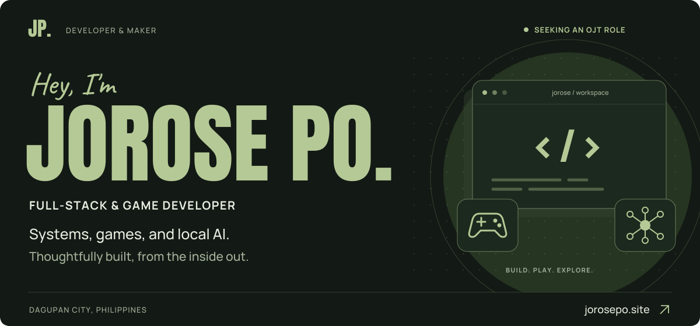
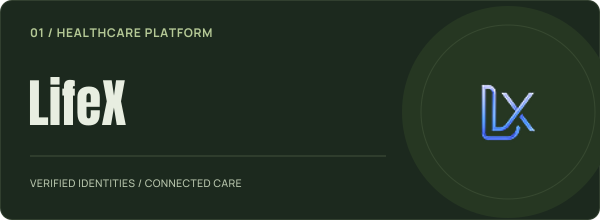
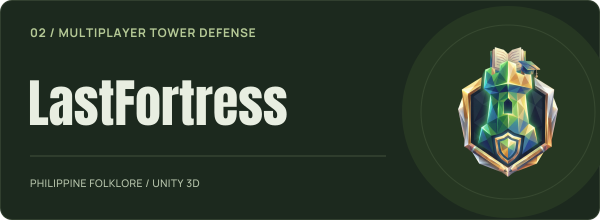
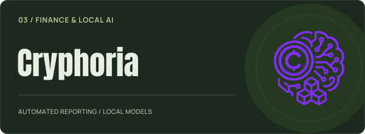
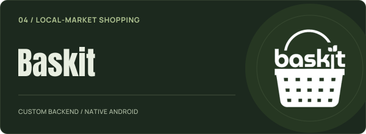
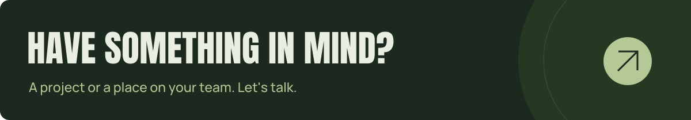

<a href="https://www.jorosepo.site/">
  <picture>
    <source media="(prefers-color-scheme: dark)" srcset="assets/profile-banner-dark.png">
    <source media="(prefers-color-scheme: light)" srcset="assets/profile-banner-light.png">
    
  </picture>
</a>

  &nbsp;
  &nbsp;
  &nbsp;
  &nbsp;
  

  <strong>Full-stack systems, games, and local AI.</strong> 
  Thoughtfully built, from the inside out.

 

## `01` — About

I'm **Jorose**, a BS Information Technology student at **PHINMA University of Pangasinan**, currently seeking an **OJT opportunity**.

I like working through how a system fits together, from its backend and data to the interface people use. My work spans healthcare platforms, multiplayer games, and AI tools that run locally. I also draw the pixel-art sprites, animations, and interfaces for my 2D games.

**Systems** &nbsp; REST APIs, authentication, identity verification, and databases. 
**Games** &nbsp; Unity gameplay, multiplayer synchronization, and original pixel art. 
**Local AI** &nbsp; Ollama / Qwen, retrieval-augmented generation, and reporting tools.

 

## `02` — Selected work

A few projects, and the parts I built.

<table>
  <tr>
    <td width="50%" valign="top">
      
      <h3>LifeX</h3>
      
An outpatient healthcare platform connecting patient records, verified identities, and digital prescriptions.

      
<strong>My part</strong> Full-stack architecture, the VerifyX identity service, record encryption, prescription signing, and pre-consultation AI.

      
<code>Django REST</code> <code>React</code> <code>PostgreSQL</code>

      
<a href="https://www.jorosepo.site/#project-name-lifex">Explore LifeX ↗</a>

    </td>
    <td width="50%" valign="top">
      
      <h3>LastFortress</h3>
      
A Unity tower defense game with multiplayer systems and creatures drawn from Philippine folklore.

      
<strong>My part</strong> The complete Unity client: core gameplay, enemy waves, and custom NetWrapper multiplayer synchronization.

      
<code>Unity</code> <code>C#</code> <code>NetWrapper</code>

      
<a href="https://www.jorosepo.site/#project-name-lastfortress">Explore LastFortress ↗</a>

    </td>
  </tr>
  <tr>
    <td width="50%" valign="top">
      
      <h3>Cryphoria</h3>
      
A cryptocurrency-based accountancy platform with automated reporting and local AI summaries.

      
<strong>My part</strong> Local Ollama / Qwen pipelines using RAG and CAG, reporting calculations, and API integration with web and mobile clients.

      
<code>Python</code> <code>Ollama</code> <code>Django REST</code>

      
<a href="https://www.jorosepo.site/#project-name-cryphoria">Explore Cryphoria ↗</a>

    </td>
    <td width="50%" valign="top">
      
      <h3>Baskit</h3>
      
A local-market shopping app where a Tagabili shopper fulfills a customer's picking list using a pickup code.

      
<strong>My part</strong> A backend built from scratch in vanilla PHP and MySQL, with REST endpoints integrated into the native Kotlin Android app.

      
<code>PHP</code> <code>MySQL</code> <code>Kotlin</code>

      
<a href="https://www.jorosepo.site/#project-name-baskit">Explore Baskit ↗</a>

    </td>
  </tr>
</table>

  <a href="https://www.jorosepo.site/#work"><strong>Explore the projects, screenshots, and development notes ↗</strong></a>

  
<strong>A little more game dev & pixel art</strong>

   
  
<strong>PETPAL</strong> — An 8-bit mobile pet-care game. I programmed the Unity gameplay and created the sprites, animations, and interface artwork in IbisPaint.

  
<strong>WatchOut!</strong> — A Python / Pygame platformer about collecting flags and avoiding enemies. I built the gameplay and drew the original pixel art.

 

## `03` — Toolkit

Tools I use across my projects.

<h3 align="center">Web & mobile</h3>

  &nbsp;
  &nbsp;
  &nbsp;
  &nbsp;
  &nbsp;
  &nbsp;
  

<h3 align="center">Backend & local AI</h3>

  &nbsp;
  &nbsp;
  &nbsp;
  &nbsp;
  &nbsp;
  

<h3 align="center">Games & art</h3>

  &nbsp;
  &nbsp;
  &nbsp;
  

Gameplay in Unity / C# and Pygame. Original sprites, animation, and UI in IbisPaint.

<h3 align="center">Data & workflow</h3>

  &nbsp;
  &nbsp;
  &nbsp;
  &nbsp;
  &nbsp;
  

 

## `04` — Let's connect

  I'm looking for an <strong>OJT role</strong> where I can contribute, learn, and keep building.

  &nbsp;
  &nbsp;
  

<a href="mailto:jorosepooo@gmail.com">jorosepooo@gmail.com</a>

---

Systems you can use. Worlds you can play.

